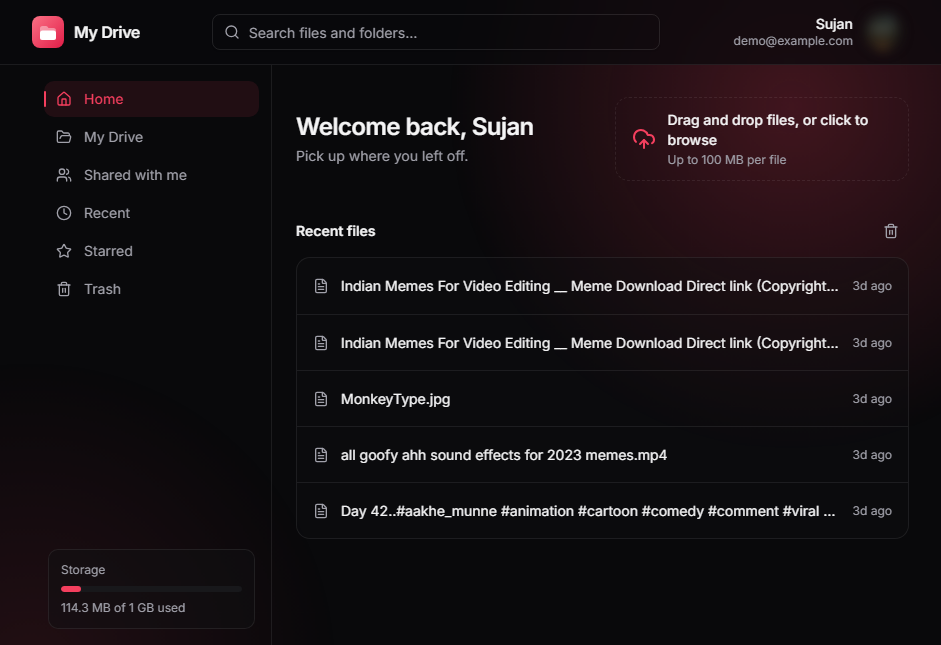
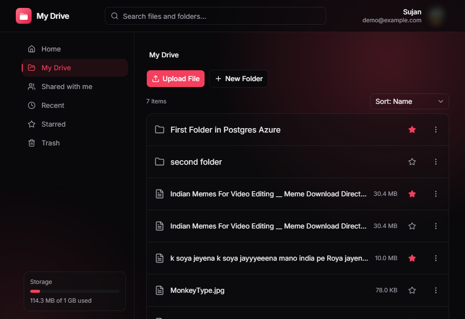
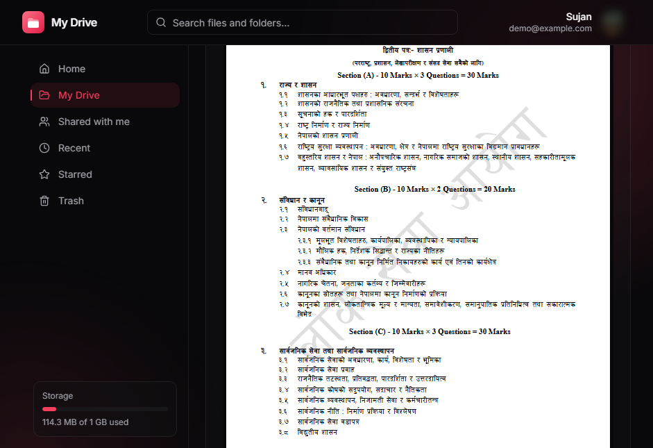
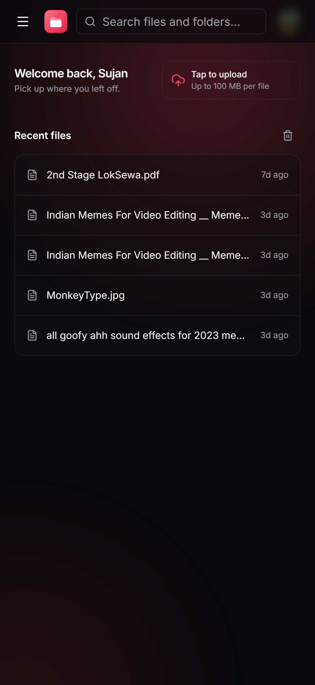
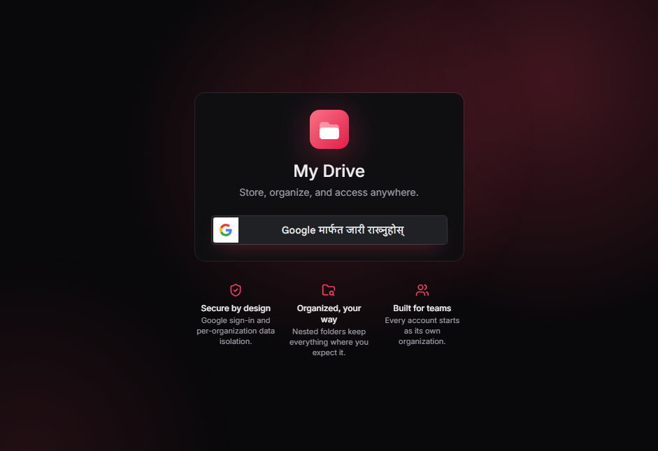
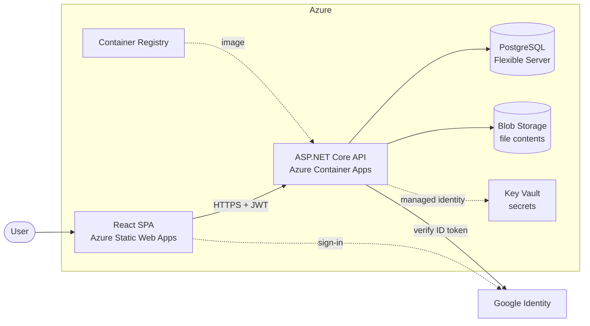
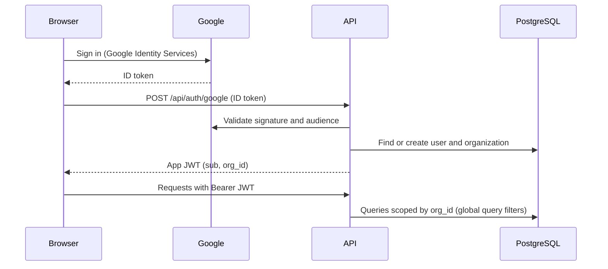
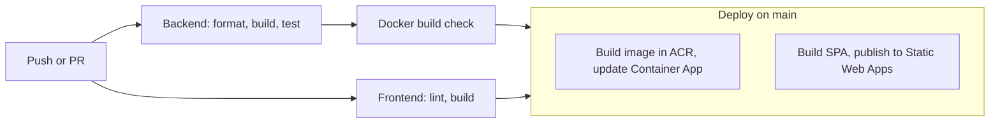

<div align="center">

# My Drive

**A multi-tenant cloud file storage app, built end to end to learn modern cloud engineering.**

[Live demo](https://victorious-desert-0312beb00.6.azurestaticapps.net) ·
[Architecture](#architecture) ·
[Getting started](#getting-started) ·
[Roadmap](#roadmap)

[](https://github.com/Sujan-369/My_Drive/actions/workflows/ci.yml)


</div>

<!-- Add your own screenshots to docs/screenshots/ with these names. -->
<p align="center">
  
</p>

---

## What is this?

My Drive is a cloud storage service for individuals and small teams. Sign in with Google, organize files in nested folders, preview PDFs, share with teammates, and stay within a per-organization storage quota.

It is also a **learning project**. It began as a cloud computing course assignment and grew into a deliberate exercise in building and operating a real service: multi-tenancy, authentication, clean layering, automated tests against a real database, containerized deployment, and a CI/CD pipeline that ships to Azure without storing any cloud credentials.

> **Try it:** [victorious-desert-0312beb00.6.azurestaticapps.net](https://victorious-desert-0312beb00.6.azurestaticapps.net)
> The API scales to zero when idle, so the first request after a quiet period can take a few seconds. The app wakes it up as soon as the page loads.

## Screenshots

| Home | Files | PDF preview |
| --- | --- | --- |
|  |  |  |

| Mobile | Sign in |
| --- | --- |
|  |  |

## Features

**Storage**
- Nested folders, multi-file upload with drag and drop, and download
- Rename, move, star, and a Trash with automatic deletion after 30 days
- Case-insensitive search across files and folders, plus Recent files and an activity log
- PDF preview with fit-to-width, pinch and Ctrl+scroll zoom, and correct fonts

**Sharing and tenancy**
- Every account starts as its own organization; data is isolated per organization
- Share files or folders with Viewer or Editor permissions; only the owning organization can grant access
- A "Shared with me" list

**Guardrails**
- Per-organization storage quota (1 GiB by default; Trash counts until it is purged)
- Upload policy: 100 MiB per file and a blocklist of executable types, enforced on both client and server with clear messages
- Folder moves are validated against cycles and cross-organization destinations

**Experience**
- Responsive layout that works on phones, with touch-sized controls
- One consistent error format from the API, translated into human-readable messages in the UI

## Architecture



### Authentication and tenancy



### Code layout

The backend follows a layered design so the business rules can be tested without a web server or a database.

| Layer | Responsibility |
| --- | --- |
| `My_Drive.Core` | Entities and business rules (`FolderService`, `ShareService`, `UploadPolicy`, quota). No infrastructure dependencies |
| `My_Drive.Infrastructure` | EF Core and migrations, repositories, Blob storage, Google token validation, JWT, background jobs |
| `My_Drive` | HTTP surface: controllers, contracts, filters, middleware |

## Tech stack

| Area | Technology |
| --- | --- |
| API | ASP.NET Core (.NET 10), EF Core, Npgsql |
| Database | PostgreSQL |
| File storage | Azure Blob Storage |
| Auth | Google Identity Services (OIDC) exchanged for a short-lived JWT |
| Frontend | React 19, TypeScript, Vite, Tailwind CSS v4, TanStack Query, shadcn/ui (Base UI), Motion |
| PDF | PDF.js |
| Tests | xUnit, Testcontainers (PostgreSQL), `WebApplicationFactory` |
| CI/CD | GitHub Actions with OIDC federation to Azure |
| Hosting | Azure Container Apps, Static Web Apps, Container Registry, Key Vault |

## Engineering highlights

- **Tenant isolation by default.** The organization comes from a JWT claim and every query is scoped through EF Core global query filters, so forgetting a `WHERE` clause cannot leak data.
- **Business rules live in Core.** `FolderService`, `ShareService`, and `UploadPolicy` are plain classes covered by fast unit tests with in-memory fakes.
- **Integration tests on real infrastructure.** Tests boot the actual API against a throwaway PostgreSQL container, run the real migrations, and use real JWTs. Only blob storage is faked.
- **Credential-free deployments.** GitHub Actions authenticates to Azure with OIDC federation, and the API reads secrets from Key Vault through a managed identity. No cloud secrets are stored in the repo or in CI.
- **Safe schema changes.** Migrations apply on startup under EF Core's database-level lock, so a second replica starting at the same time is safe.
- **Defensive uploads.** Size and type checks run before the request is parsed, the filename is validated before anything is written to blob storage, and a failed database write cleans up the blob.
- **Soft delete with retention.** Deleted items go to Trash and a background service purges them after 30 days.
- **A careful PDF viewer.** Device-pixel-ratio rendering, a canvas size cap for iOS Safari, off-screen rendering so zooming never flashes blank, and bundled font and CMap data.

## Getting started

### Prerequisites

- [.NET 10 SDK](https://dotnet.microsoft.com/download)
- [Node.js 24](https://nodejs.org/) (22.13 or newer works)
- [Docker](https://www.docker.com/) for PostgreSQL, Azurite, and the integration tests
- A Google OAuth client ID ([create one](https://console.cloud.google.com/apis/credentials)) with `http://localhost:5173` as an authorized JavaScript origin

### 1. Start PostgreSQL and the Blob emulator

```bash
docker run --name mydrive-db -e POSTGRES_PASSWORD=postgres -p 5432:5432 -d postgres:17-alpine
docker run --name mydrive-blobs -p 10000:10000 -d mcr.microsoft.com/azure-storage/azurite azurite-blob --blobHost 0.0.0.0
```

### 2. Run the API

```bash
cd My_Drive
dotnet user-secrets set "ConnectionStrings:DefaultConnection" "Host=localhost;Port=5432;Database=mydrive;Username=postgres;Password=postgres"
dotnet user-secrets set "Jwt:Key" "<at least 32 random characters>"
dotnet user-secrets set "Jwt:Issuer" "my-drive-api"
dotnet user-secrets set "Jwt:Audience" "my-drive-client"
dotnet user-secrets set "Google:ClientId" "<your Google OAuth client id>"
dotnet user-secrets set "Azure:BlobStorageConnectionString" "UseDevelopmentStorage=true"
dotnet run
```

The API listens on <http://localhost:5271> and applies database migrations on startup. In Development, the API reference is served at `/scalar`.

### 3. Run the web app

```bash
cd client
npm install
```

Create `client/.env`:

```bash
VITE_API_BASE_URL=http://localhost:5271
VITE_GOOGLE_CLIENT_ID=<your Google OAuth client id>
```

```bash
npm run dev
```

Open <http://localhost:5173>.

## Configuration

All settings can be overridden with environment variables (use `__` for nesting, for example `Upload__MaxFileBytes`).

| Setting | Default | Purpose |
| --- | --- | --- |
| `Storage:OrgQuotaBytes` | `1073741824` (1 GiB) | Storage limit per organization, Trash included |
| `Upload:MaxFileBytes` | `104857600` (100 MiB) | Maximum size of a single file |
| `Upload:BlockedExtensions` | `.exe .msi .bat .cmd .com .scr .dll .vbs .ps1 .jar` | File types that cannot be uploaded |
| `Jwt:ExpiryMinutes` | `60` | Lifetime of an app token |
| `Cors:AllowedOrigins` | `localhost:5173`, `localhost:5174` | Origins allowed to call the API |
| `Database:MigrateOnStartup` | `true` | Apply pending EF Core migrations at boot |

## Testing

```bash
dotnet test                              # unit tests + integration tests (Docker required)
dotnet test --filter "Category!=Integration"   # skip tests that need Docker, if tagged

cd client
npm run lint
npm run build
```

## API overview

| Area | Endpoints |
| --- | --- |
| Auth | `POST /api/auth/google`, `GET /api/auth/me`, `POST /api/auth/me/clear-recent` |
| Folders | `GET/POST /api/folders`, `PUT /{id}/rename`, `PUT /{id}/move`, `DELETE /{id}`, `PUT /{id}/restore`, `DELETE /{id}/permanent`, `PUT /{id}/star`, `POST /{id}/share` |
| Files | `GET/POST /api/files`, `GET /{id}/download`, `GET /{id}/detail`, `GET /{id}/shares`, plus rename, move, delete, restore, star, share |
| Search | `GET /api/search?q=` |
| Sharing | `GET /api/shares/shared-with-me` |
| Activity | `GET /api/activity/recent` |
| Organization | `GET /api/organizations/storage-usage`, `GET /api/organizations/upload-policy` |

Every error response uses the same shape: `{ "message": "..." }`.

## Deployment



The pipeline is defined in [`.github/workflows/ci.yml`](.github/workflows/ci.yml). It needs these repository settings:

| Type | Name | Purpose |
| --- | --- | --- |
| Secret | `AZURE_CLIENT_ID`, `AZURE_TENANT_ID`, `AZURE_SUBSCRIPTION_ID` | OIDC login to Azure (no client secret) |
| Secret | `AZURE_STATIC_WEB_APPS_API_TOKEN` | Publish the SPA |
| Variable | `VITE_API_BASE_URL`, `VITE_GOOGLE_CLIENT_ID` | Build-time frontend configuration |
| Variable | `FRONTEND_ORIGIN` | Allowed CORS origin for the API |

## Security

- Google ID tokens are validated server-side for signature and audience, then exchanged for a short-lived JWT.
- Tenant isolation is enforced centrally by query filters, and cross-organization access requires an explicit share.
- Secrets come from Key Vault through a managed identity; nothing sensitive is committed.
- The web app sets security headers (`Cross-Origin-Opener-Policy`, `X-Content-Type-Options`, `Referrer-Policy`, `X-Frame-Options`).

Found a vulnerability? Please open a private report through the repository's **Security** tab instead of a public issue.

## Roadmap

This is a learning project, so the roadmap doubles as a list of known limitations.

- [ ] Browse shared folders, revoke shares, and change permissions
- [ ] Share expiry in the UI (the data model already supports it)
- [ ] Content-hash deduplication (hashes are already stored)
- [ ] Upload new file versions (history is already modeled)
- [ ] Stream uploads instead of buffering them in memory
- [ ] Rate limiting and structured logging
- [ ] Malware scanning for uploads
- [ ] Privacy policy and terms pages
- [ ] Frontend bundle splitting and a full accessibility pass

## Contributing

Issues and suggestions are welcome. For anything larger than a small fix, please open an issue first so we can agree on the approach. Before opening a pull request, run `dotnet format`, `dotnet test`, and `npm run lint && npm run build` in `client/`.

## License

Released under the [MIT License](LICENSE).

## Author

Built by **Sujan** ([@Sujan-369](https://github.com/Sujan-369)) while learning cloud engineering.
